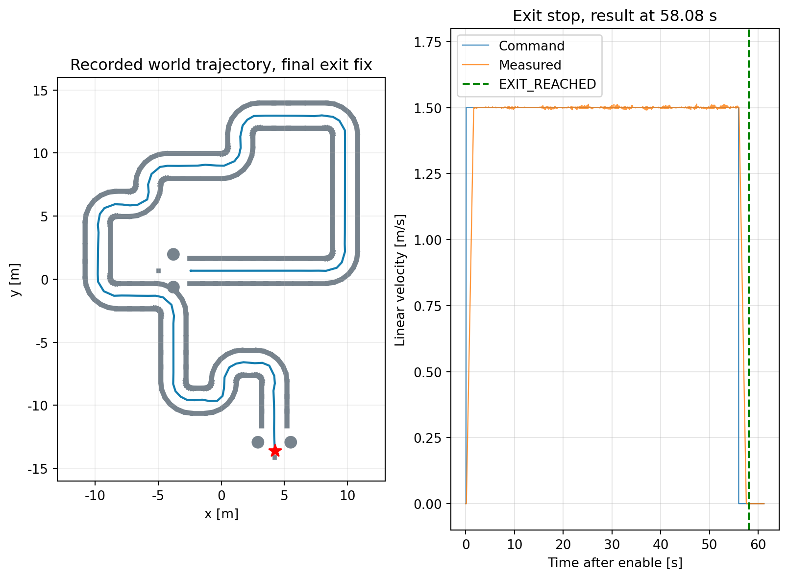
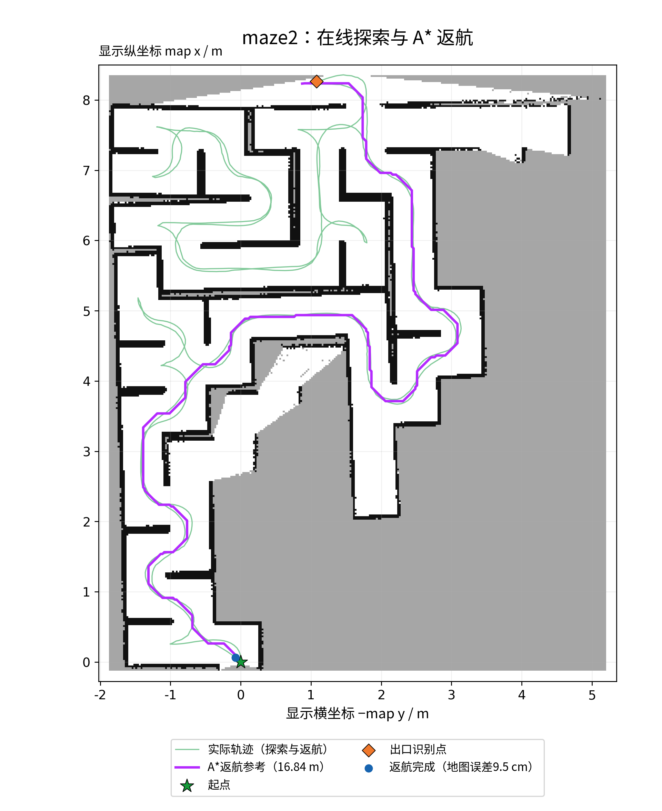

# ROS 2 差速机器人：PID 左墙追踪与 PP 迷宫搜索

《机器人感知与控制综合实践》第11组课程项目。使用 TurtleBot3 Burger，在 Gazebo 中完成连续走廊左墙追踪，以及多岔路迷宫在线探索、出口识别和自主返航。

**课程代码：`(2026-2027-1)-S0610350-02`** · 2026—2027学年第一学期 · 教学班02班

**公开仓库：<https://github.com/Zythyra/maze_ws>**

| 成员 | 学号 | 独立负责模块 |
| --- | --- | --- |
| 丁俊豪（组长） | 24061435 | PP迷宫搜索：拓扑探索、Dijkstra节点调度、SLAM几何辅助、PP追踪与A*返航 |
| 刘韩旭 | 24061412 | PID左墙追踪：激光墙线提取、净宽估计、双墙融合、复合控制与出口停车 |

两位成员共同确定系统框架与算法方案，完成接口集成、调参、实验分析和成果整理。

## 项目与运行效果

| 项目 / 软件包 | 默认场景 | 启动入口 | 默认速度 | 完成状态 |
| --- | --- | --- | --- | --- |
| PID左墙追踪 `maze_wall_pid` | `merged_maze.world`，含连续S弯 | `merged.launch.py` | 1.5 m/s | 驶出并停稳：`EXIT_REACHED` |
| PP迷宫搜索 `maze_bringup` | `maze2.world`，含岔路与死路 | `maze2.launch.py` | 0.53 m/s | 出口后返航起点：`HOME_REACHED` |

两个入口均加载机器人、world、Gazebo、RViz和控制器。启动后先等待，在**启动launch的同一终端输入 `start` 并回车**开始运动；每次选择一个项目运行。



PID最终记录中，1.5 m/s配置约58.08 s完成合并迷宫并正常停车。PP的maze2记录中，A*返航参考长度16.839 m，出口确认至回到起点32.64 s，终止地图距离0.0951 m。日期、参数轮次、原始记录及测试结果见[实验记录](docs/EXPERIMENTS.md)。

## 环境与依赖

| 组件 | 版本 / 用途 |
| --- | --- |
| Ubuntu | 22.04 LTS |
| ROS 2 | Humble |
| Gazebo | Classic 11 |
| TurtleBot3 | Burger，官方Humble模型与插件 |
| `slam_toolbox` | PP在线SLAM与位姿图 |
| Python / C++ | 系统Python 3、C++墙线控制器；NumPy、SciPy、OpenCV |

`src/vendor/`包含`turtlebot3_description`、`turtlebot3_gazebo`及模型、许可证和上游版本记录。两个项目包可分别构建和运行。

## 下载与编译

```bash
git clone https://github.com/Zythyra/maze_ws.git ~/maze_ws
cd ~/maze_ws
source /opt/ros/humble/setup.bash
rosdep update
rosdep install --from-paths src --ignore-src -r -y
MAKEFLAGS=-j2 CMAKE_BUILD_PARALLEL_LEVEL=2 \
  colcon build --symlink-install --executor sequential \
  --packages-up-to maze_wall_pid maze_bringup
source install/local_setup.bash
```

新安装ROS后若尚未初始化rosdep，先执行一次`sudo rosdep init`。解压代码包时，从上述`cd ~/maze_ws`开始操作。每个新终端加载ROS环境和工作空间：

```bash
source /opt/ros/humble/setup.bash
source ~/maze_ws/install/local_setup.bash
```

仅构建单个项目可使用`colcon build --symlink-install --packages-up-to maze_wall_pid`或`--packages-up-to maze_bringup`。

## PID：合并迷宫左墙追踪

```bash
ros2 launch maze_wall_pid merged.launch.py
# 窗口就绪后，在同一终端输入：
start
```

出生位置`(-2.45, 0.6701, 0.01)`，yaw=0，从内侧入口沿+X方向进入。控制器从连续墙点生成等弧长参考线，目标墙距取可靠净宽一半，初值0.85 m。双墙按可见弧长和拟合残差融合，正常角速度由**曲率前馈＋朝向修正＋横向PID**组成；几何失效时使用加权横向误差回退。前方危险优先原地右转，连续丢线则向左寻墙。出口经过开阔确认、保持航向驶出、制动与实测停稳确认后结束。

参数：[`merged_left2.yaml`](src/maze_wall_pid/config/merged_left2.yaml)；核心：[`left2_lidar.cpp`](src/maze_wall_pid/src/left2_lidar.cpp)、[`left2_trace.hpp`](src/maze_wall_pid/include/maze_wall_pid/left2_trace.hpp)。详见[PID软件包](src/maze_wall_pid/README.md)。

## PP：maze2在线探索与返航

```bash
ros2 launch maze_bringup maze2.launch.py
# 窗口就绪后，在同一终端输入：
start
```

出生位置`(-2.275, -3.8, 0.01)`，yaw=π/2，从下方缺口朝+Y进入。

1. **拓扑图管理探索**：保存节点、道路连接与四方向支路状态；左右缺口均登记，本地按左、前、右、后优先探索。
2. **SLAM辅助拓扑**：统一map坐标，通过关键帧锚点和墙面约束修正节点及参考线，并判断已完整观测的死路。
3. **Dijkstra调度节点**：在已连接、标记visited的拓扑道路上累计边长，选择最近且仍有未探索支路的岔路；道路序列拼成连续PP参考线。
4. **PP执行运动**：用前瞻圆交点计算曲率，结合短时位姿预测和角速度反馈追踪折线。探索巡航上限0.53 m/s，前瞻0.32 m。
5. **出口后A*返航**：确认出口后，在SLAM已知安全栅格中规划到记录起点的路线，由PP跟踪；地图距离小于0.10 m时锁定停车。



核心：[`polyline_core.py`](src/maze_bringup/scripts/polyline_core.py)、[`polyline_follower.py`](src/maze_bringup/scripts/polyline_follower.py)、[`branch_map.py`](src/maze_bringup/scripts/branch_map.py)、[`return_planner.py`](src/maze_bringup/scripts/return_planner.py)。参数：[`polyline.yaml`](src/maze_bringup/config/polyline.yaml)、[`slam.yaml`](src/maze_bringup/config/slam.yaml)。详见[PP软件包](src/maze_bringup/README.md)。

## 操作与话题

| 话题 / 服务 | 用途 |
| --- | --- |
| `/scan` | `sensor_msgs/msg/LaserScan`，360点扫描 |
| `/odom`、`/imu` | 融合里程计、偏航反馈 |
| `/cmd_vel` → `/burger/cmd_vel` | 控制器指令经速度保护转发到底盘 |
| `/wall_follow/status`、`/wall_follow/result` | PID状态与任务结果 |
| `/polyline/status`、`/polyline/result` | PP探索、回溯、返航与完成状态 |
| `/polyline/graph`、`/polyline/astar_return_path` | 探索拓扑和A*返航路径 |

```bash
ros2 topic echo /scan --once
ros2 topic echo /odom --once
# PID暂停 / 恢复
ros2 service call /wall_follow/set_enabled std_srvs/srv/SetBool '{data: false}'
ros2 service call /wall_follow/set_enabled std_srvs/srv/SetBool '{data: true}'
# PP暂停 / 恢复
ros2 service call /polyline/set_enabled std_srvs/srv/SetBool '{data: false}'
ros2 service call /polyline/set_enabled std_srvs/srv/SetBool '{data: true}'
```

无窗口运行可加`gazebo_gui:=false use_rviz:=false`，PID另加`debug_window:=false`。`wait_for_start:=false`设为自动开始。任务完成后维持停车，新一轮任务重新启动launch。

## 目录与课程材料

```text
maze_ws/
├── src/
│   ├── maze_wall_pid/       # PID、参数、合并迷宫、launch及测试
│   ├── maze_bringup/        # PP、拓扑/SLAM协同、返航、maze2及测试
│   └── vendor/              # 官方Burger模型、仿真资源及许可证
├── docs/
│   ├── EXPERIMENTS.md       # 实验轮次与结果
│   ├── VALIDATION.md        # 构建、回归和启动检查
│   ├── SOURCES.md           # 外部代码、模型和地图来源
│   ├── images/              # 实测轨迹及Gazebo/RViz画面
│   ├── results/             # 与图表对应的结果记录
│   └── report/              # 课程报告Word与PDF
├── LICENSE
└── requirements-mpc.txt     # 可选拓展依赖
```

[课程报告PDF](docs/report/11_丁俊豪_刘韩旭_综合设计报告.pdf) · [课程报告Word](docs/report/11_丁俊豪_刘韩旭_综合设计报告.docx) · [实验记录](docs/EXPERIMENTS.md) · [代码与地图来源](docs/SOURCES.md)

GitHub保存源码和公开文档；课程提交ZIP按整工作空间组织，排除根目录`build/`、`install/`，解压后重新编译。

## 回归检查

```bash
cd ~/maze_ws
source /opt/ros/humble/setup.bash
source install/local_setup.bash
colcon test --packages-select maze_bringup maze_wall_pid --event-handlers console_direct+
colcon test-result --verbose
```

两个课程项目相关的5组测试共125个用例，覆盖PP拓扑、地图死路判定、A*返航、启动门控和C++墙线/PID。完整工作空间还保留拓展控制器的测试，详见[验证记录](docs/VALIDATION.md)。

## 可选拓展：差速MPC

仓库保留差速MPC和平滑参考对照代码，作为课程两个项目之外的拓展实验。依赖OSQP 1.0.4：

```bash
cd ~/maze_ws
python3 -m pip install --user --no-deps -r requirements-mpc.txt
ros2 launch maze_bringup mpc_maze2.launch.py
```

该入口同样等待start，使用maze2，速度上限0.60 m/s。课程报告讨论PID与纯PP方案。

## AI辅助与开源来源

系统框架、算法方案、参数取舍与实验结论由两名组员确定。AI按既定方案辅助代码编写、ROS 2适配、排错和资料整理，并辅助报告润色、流程图绘制及排版。组员完成方案集成、调参、实验分析和内容完善；图表依据保存的仿真记录制作。

PID巡线思路与有界PID参考[既有ROS 1 left2.cpp](https://github.com/Zythyra/ifly2_2026/blob/main/src/line_follow/src/left2.cpp)，机器人模型来自[ROBOTIS TurtleBot3](https://github.com/ROBOTIS-GIT/turtlebot3)和[官方仿真包](https://github.com/ROBOTIS-GIT/turtlebot3_simulations)，在线SLAM使用[slam_toolbox](https://github.com/SteveMacenski/slam_toolbox)。版本与改编范围见[SOURCES](docs/SOURCES.md)。本仓库采用[Apache-2.0](LICENSE)，外部资源保留各自许可证和来源记录。
