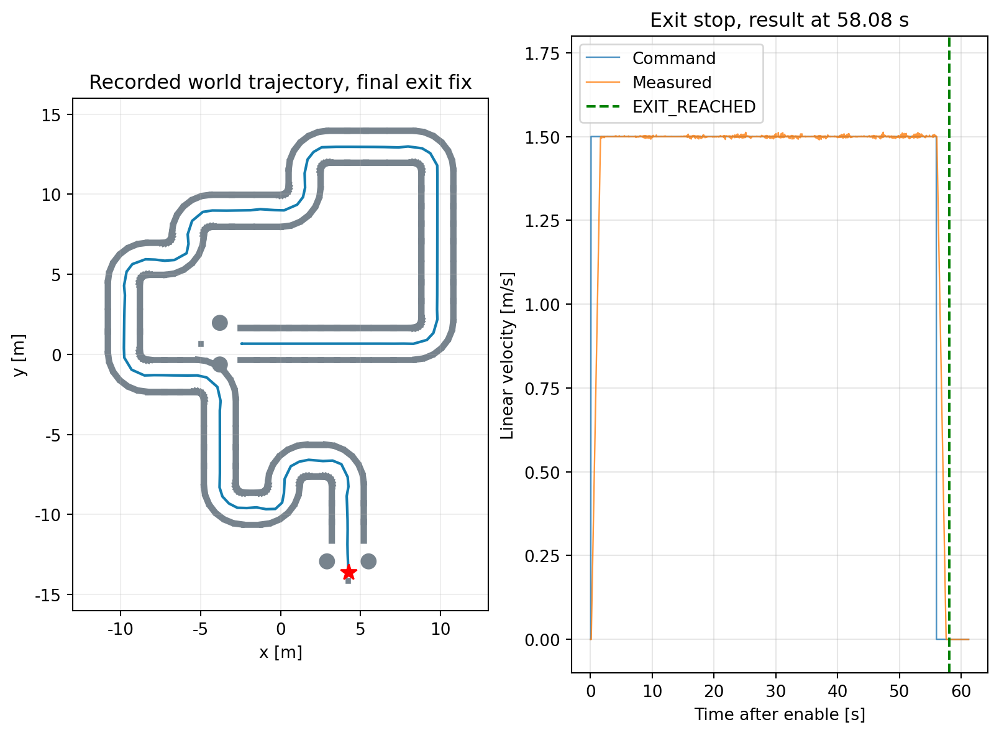
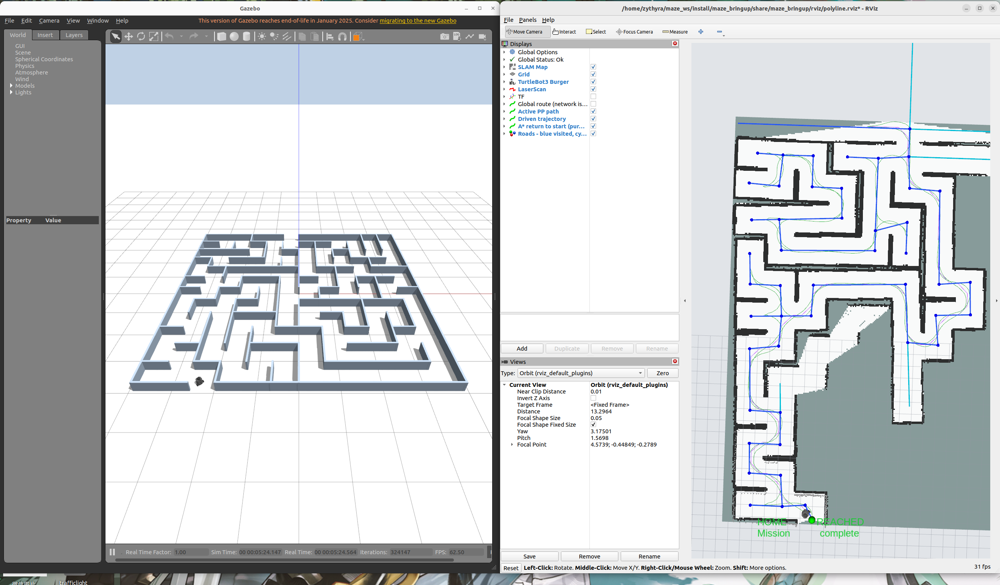
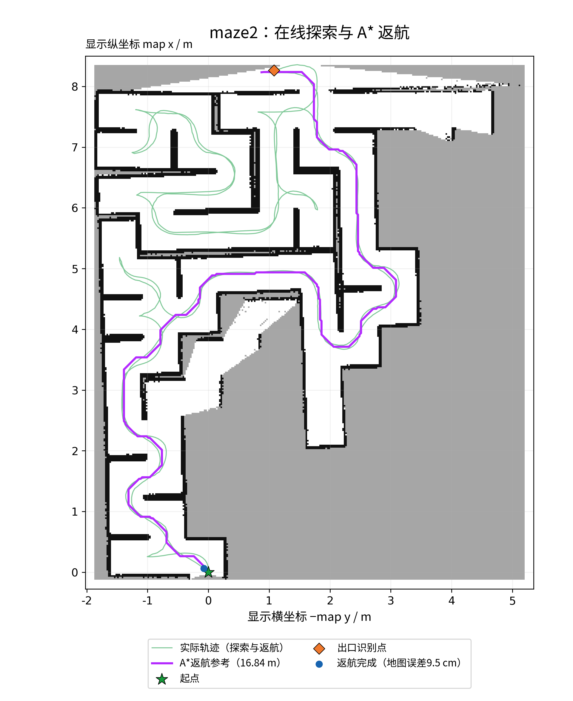

# 课程实验记录

课程：`(2026-2027-1)-S0610350-02`，第11组，丁俊豪 / 刘韩旭。

环境为Ubuntu 22.04、ROS 2 Humble、Gazebo Classic 11及TurtleBot3 Burger。算法源码基线为提交`61b83f83df0547c05d0216452d4d7ea4b6e5398f`；课程文档、报告和实验资料在后续文档提交中补齐。

## PID：合并迷宫左墙追踪

2026年10月27日，从合并迷宫内侧入口运行连续直道与L/U/Z/S弯。控制器采用双墙几何融合、曲率前馈、朝向修正与横向PID。以下时间取记录中的启用事件至完成事件。

| 原始轮次 | 巡航速度 | 出口开阔确认 | 耗时 | 观察结果 |
| --- | --- | --- | --- | --- |
| `full_final` | 1.0 m/s | 0.20 s | 83.52 s | 完成路线并停车，`EXIT_REACHED` |
| `full_speed15` | 1.5 m/s | 0.20 s | 70.10 s | 出口外出现绕柱和贴墙现象 |
| `full_speed15_exitfix` | 1.5 m/s | 0.10 s | 58.08 s | 正常驶出并停稳，`EXIT_REACHED` |

最终轮次记录21帧`EXIT_BRAKING`，随后保持`EXIT_REACHED`。世界坐标停车位置约`(4.238, -13.595, 0.009887)` m。出口开始制动的最小进度为0.30 m，实测线速度小于0.02 m/s、角速度小于0.10 rad/s持续0.50 s后锁定完成。

数据：[三轮结果、状态计数及停车位置](results/pid_runs.json)。图由原始位姿和速度采样重绘，完整压缩日志随课程工作空间代码包提供。

## PP：maze2探索、Dijkstra节点转移与A*返航

2026年10月20日运行maze2。机器人边探索边维护道路拓扑与SLAM地图，登记左右岔路并左优先选择；需要转移到其他待探索岔路时，Dijkstra按已连接拓扑道路的累计长度选择最短路线。SLAM辅助定位、锚点更新、墙面校正与已知死路判定。识别出口后，在已知安全栅格上运行A*返航，再由PP跟踪回到起点。

| 指标 | 记录值 |
| --- | --- |
| 出生位置 | `(-2.275, -3.8, 0.01)` m，yaw=π/2 |
| PP巡航上限 | 0.53 m/s |
| A*返航参考长度 | 16.839 m |
| A*扩展栅格数 | 18 326，1次规划得到路径 |
| 出口确认至`HOME_REACHED` | 32.64 s，仿真时间 |
| 终止时距起点 | 0.0951 m，SLAM地图坐标 |
| 起点到达容差 | 0.10 m |
| 完成后的停车观察 | 约90.74 s，非零指令样本为0 |

地图视角按`(显示横坐标, 显示纵坐标)=(-map y, map x)`旋转，标题和图例保持正向。绿色为实际轨迹，紫色为A*参考；星形为起点。

数据：[运行汇总](results/pp_return_validation.json)、[最终状态、完整轨迹与A*参考](results/pp_return_final.json)。

## 构建、回归与启动检查

2026年11月2日的软件包拆分后重新构建成功，三个现有入口完成传感器接收、等待start、服务启用和暂停停车检查。课程两个项目相关测试如下：

| 测试文件 | 用例数 | 结果 |
| --- | --- | --- |
| `test_left2_trace` | 18 | 通过 |
| `test_polyline` | 63 | 通过 |
| `test_return_planner` | 13 | 通过 |
| `test_branch_map` | 24 | 通过 |
| `test_terminal_start` | 7 | 通过 |
| 合计 | 125 | 0失败 |

这些用例检查算法几何、状态和接口；上文完整路线记录评价仿真运动与任务结果。[VALIDATION](VALIDATION.md)记录完整工作空间的构建和测试汇总。
